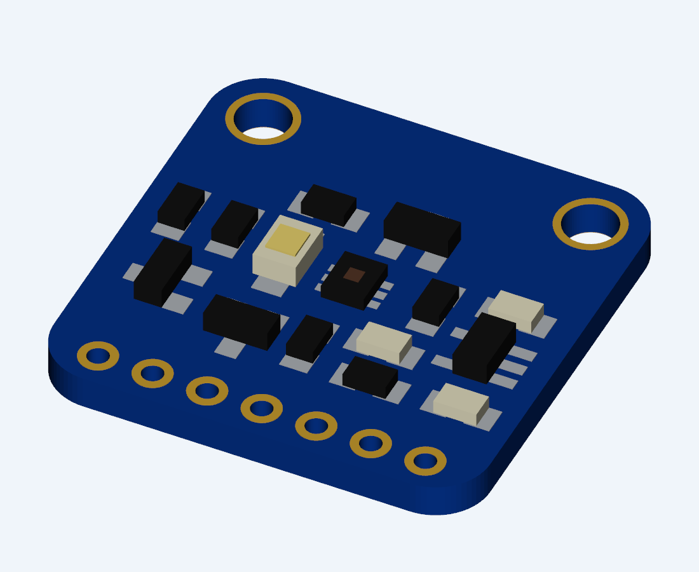

# Adafruit TCS34725 para Altium

Componente reutilizable del módulo Adafruit TCS34725 completo.

## Uso

Abrir `Adafruit_TCS34725_Module.IntLib` en Altium y elegir instalar la biblioteca. En el panel **Components**, seleccionar la biblioteca y colocar `ADAFRUIT_TCS34725_MODULE` en el esquemático del proyecto.

La biblioteca integrada contiene el símbolo cuadrado de siete pines, el footprint y el modelo 3D embebido. No requiere un STEP externo. Conservar la biblioteca en una carpeta permanente.

## Archivos editables

- `Adafruit_TCS34725_Module.SchLib`: símbolo y asociación al footprint.
- `Adafruit_TCS34725_Module.PcbLib`: footprint y cuerpo 3D.
- `Adafruit_TCS34725_Module.LibPkg`: paquete para recompilar la IntLib en Altium.
- `Adafruit_TCS34725_Module.step`: modelo 3D separado.
- `pinout.json`: numeración y coordenadas de los contactos.

Después de editar las fuentes, compilar el paquete en Altium y actualizar la IntLib de este repositorio con el resultado.

## Geometría y pinout

Dimensiones: **20,32 × 20,32 mm**, radio de esquinas 2,54 mm. Contactos a paso 2,54 mm, taladros de 1 mm y pads de 1,778 mm. Dos agujeros de montaje de 2,5 mm en (2,54; 17,78) y (17,78; 17,78) mm. El origen coincide con la esquina inferior izquierda de la placa original.

| Pin | Función |
| --- | --- |
| 1 | VIN |
| 2 | GND |
| 3 | 3V3, salida del regulador |
| 4 | SCL |
| 5 | SDA |
| 6 | INT |
| 7 | LED |

El símbolo usa una asociación de pines a pads por el mismo número. MH1 y MH2 son agujeros mecánicos sin conexión eléctrica. El contorno del módulo está en serigrafía/documentación; la placa principal conserva su propio contorno.

## Modelo 3D y verificación

La geometría XY se obtuvo de los archivos `Adafruit TCS34725.sch` y `.brd` suministrados. El modelo fue reconstruido y no es un STEP oficial. El espesor de placa adoptado es 1,6 mm; las alturas de los componentes son aproximadas. No incluye el conector de pines. El standoff inicial es 0 mm; ajustarlo si el módulo se monta elevado.

Verificado en Altium Designer 26.6: símbolo de siete pines, mapa 1:1, footprint y modelo 3D. La IntLib compilada contiene las fuentes SchLib y PcbLib comprimidas y está disponible en Components.

## Procedencia

Diseño del módulo: [Adafruit TCS34725, producto 1334](https://www.adafruit.com/product/1334). Este repositorio contiene una adaptación para Altium; no es una biblioteca oficial de Adafruit. No se asigna una licencia nueva al diseño original.
